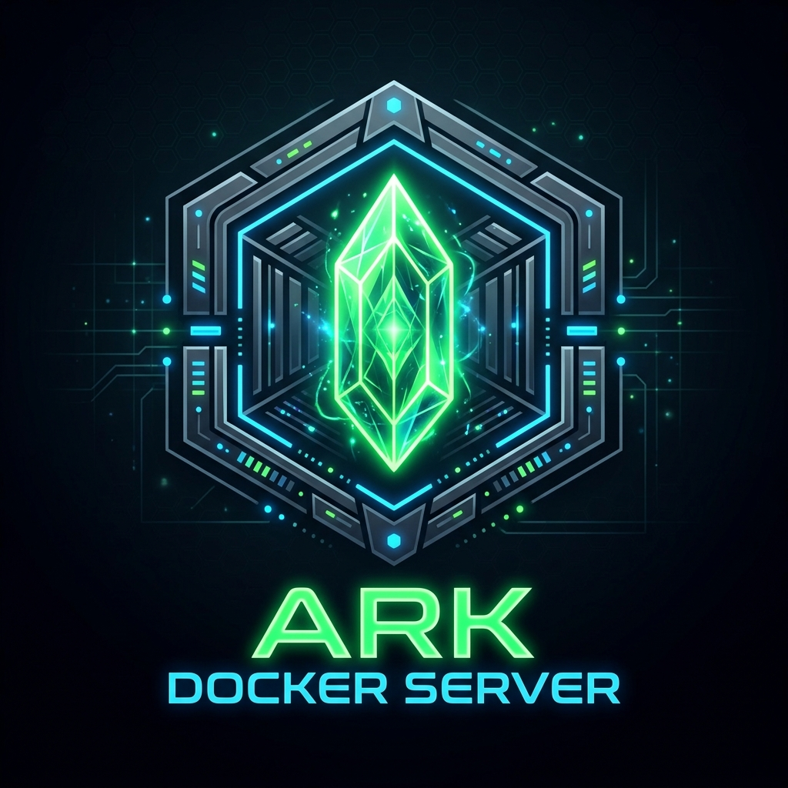

<table>
  <tr>
    <td width="130" align="center" valign="middle">
      
    </td>
    <td valign="middle">
      <h2>🧟 PZ Server Manager — Dedicated Project Zomboid Server (Docker)</h2>
      <p><strong>Panel web automatizado y ligero para desplegar y administrar servidores dedicados de Project Zomboid (Steam &amp; No-Steam / GOG) en Docker.</strong></p>
      <p>
        <a href="https://www.docker.com/"></a>
        <a href="https://projectzomboid.com/"></a>
        <a href="https://fastapi.tiangolo.com"></a>
        <a href="CHANGELOG.md"></a>
        <a href="https://gmsec.cc"></a>
        <br />
        
      </p>
    </td>
  </tr>
</table>

<p>
  🌐 <strong>Select Language / Selecciona Idioma:</strong> <a href="#-versión-en-español"><strong>ES Español</strong></a> | <a href="#-english-version"><strong>EN English</strong></a>
</p>

---

## 🇪🇸 Versión en Español

### 💡 ¿Por qué PZ Server Manager? (1 Contenedor = 1 Servidor Dedicado)

Administrar un servidor dedicado de Project Zomboid suele implicar editar manualmente archivos `.ini`, `SandboxVars.lua`, listas de Steam Workshop, respaldos por consola o paneles multi-servidor pesados que exigen bases de datos externas (MySQL/PostgreSQL), colas (Redis) y varios servicios en segundo plano.

**PZ Server Manager sigue un enfoque limpio y dedicado: 1 Contenedor = 1 Servidor de Project Zomboid.**

- **Docker se encarga solo de la infraestructura**: puertos, límite de RAM del contenedor, volúmenes persistentes y credenciales de acceso al panel.
- **Toda la gestión del juego vive en la web**: asistente inicial, consola interactiva, ajustes del servidor y sandbox, jugadores, archivos, mods, respaldos, tareas y alertas en un único servicio **FastAPI + Uvicorn** sin dependencias externas.
- **Listo para Steam y No-Steam (GOG)**: descarga automática de binarios (AppID `380870`) mediante DepotDownloader/SteamCMD y adaptación automática de opciones según la plataforma elegida.

---

### ✨ Características Principales

- 🕹️ **Asistente Inicial (Setup / Instalador)**: Configura el nombre de perfil (`SERVER_NAME`), plataforma (**Steam** o **No-Steam / GOG**), contraseñas, memoria JVM (`-Xms` / `-Xmx`), rama (`Estable`, `unstable` / Build 42, `legacy41`) y mods iniciales con progreso de descarga en vivo. Al finalizar, la pestaña de instalación se oculta automáticamente.
- 📟 **Consola Interactiva en Tiempo Real**:
  - Transmisión de logs vía WebSocket, filtro de salida, descarga de `console.txt`, analizador automático de **Diagnóstico** e historial con flechas `↑`/`↓`.
  - **Desplegable de Plantillas PZ (`Plantillas PZ...`)** organizado por categorías (*Jugadores, Teletransporte, Ítems/XP/Vehículos, Mundo/Clima, Servidor*) que autocompleta la sintaxis y muestra en vivo qué hace cada comando.
  - Botones de **Iniciar / Detener / Reiniciar** sincronizados en tiempo real con el estado del servidor.
- 📊 **Métricas y Banner de Conexión**: CPU, RAM del proceso PZ, uso de disco, jugadores en línea y botón **IP:Puerto** compatible con direcciones personalizadas (**Playit.gg / VPN / Dominio**).
- 👥 **Supervivientes y Moderación**: Lista en línea e historial con estado, copia rápida de `SteamID`, asignación de roles (`setaccesslevel`), mensajes directos, expulsión (`kick`), baneo/desbaneo y acciones de administrador.
- ⚙️ **Ajustes Integrales y Sandbox Visual**:
  - Edición completa de `<SERVER_NAME>.ini`, `*_SandboxVars.lua`, `spawnregions.lua` y plantillas rápidas (*Apocalipsis, Superviviente, Constructor, 6 Meses Después, Corredores Letales*).
  - **Opciones adaptadas por modo**: en modo **No-Steam / GOG (`-nosteam`)**, las opciones exclusivas de Steam (`Public`, `SteamVAC`, `SteamScoreboard` y Workshop) se ocultan y deshabilitan automáticamente.
  - **Recarga en caliente (`reloadoptions`)** y **Wipe de Mundo (Día 1)** conservando ajustes, mods y cuentas.
- 🧩 **Gestor de Mods (Steam Workshop)**: Resolución de IDs y colecciones de Workshop con sincronización separada de `WorkshopItems=` y `Mods=` (deshabilitado automáticamente en modo No-Steam/GOG).
- 📁 **Gestor de Archivos (`/Zomboid`)**: Exploración de carpetas, subida múltiple por arrastrar y soltar, editor de texto en línea, duplicado/renombrado y compresión/extracción `.zip`.
- 💾 **Respaldos Selectivos y Retención**: Copias de seguridad manuales o programadas eligiendo qué incluir (`Saves`, `Server`, `db`), formato `.tar.gz` o carpeta, restauración en 1 clic y políticas `max_keep` / `max_days`.
- ⏰ **Tareas Programadas**: Automatización de reinicios, guardados, respaldos, comandos o anuncios por intervalos, expresiones **Cron** y horario de encendido/apagado con avisos previos en partida.
- 🔔 **Webhooks Multicanal y Registros**: Alertas hacia **Discord**, **Telegram** y **Email (SMTP)** por evento, más registro auditable exportable a **CSV**.
- 🔒 **Seguridad**: Sesiones firmadas con HMAC, bloqueo temporal por fuerza bruta (`429`), cabeceras de seguridad HTTP y ejecución sin privilegios `root` para el panel y el servidor PZ.

---

### 🌐 Comparativa de Modos: Steam vs No-Steam (GOG)

| Capacidad | Steam (`use_steam=true`) | No-Steam / GOG (`-nosteam`) |
| :--- | :---: | :---: |
| Descarga automática de binarios (`AppID 380870`) | ✅ | ✅ |
| Mods automáticos desde Steam Workshop | ✅ | ❌ _(manual en cliente/servidor)_ |
| Buscador público (`Public`), `SteamVAC`, `SteamScoreboard` | ✅ | ❌ _(deshabilitado automáticamente)_ |
| Conexión directa por IP:Puerto / Playit.gg | ✅ | ✅ |
| Clientes compatibles | Steam | GOG / Steam `-nosteam` |

---

### 🔌 Puertos y Red

| Puerto | Protocolo | Descripción |
| :---: | :---: | :--- |
| `16261` | `UDP` | Puerto principal de juego y handshake (`DefaultPort`) |
| `16262` | `UDP` | Puerto de conexión directa / query (`UDPPort`) |
| `8580` | `TCP` (`-> 8080`) | Panel Web de Administración (`PANEL_PORT`) |

> **¿Usas Playit.gg, Tailscale u otro túnel?** Configura **Dirección Pública IP:Puerto** en **Ajustes → Servidor & Acceso** (o la variable `PZ_PUBLIC_ADDRESS`) para mostrar esa dirección en el banner superior y copiarla al pulsar **IP:Puerto**.

---

### 🚀 Despliegue con Docker Compose (Recomendado)

#### Opción 1: Clonar el repositorio oficial

1. Clona el repositorio y entra en la carpeta:

   ```bash
   git clone https://github.com/GMS-EC/project-zomboid-docker-server.git
   cd project-zomboid-docker-server
   ```

2. Crea tu `.env` a partir de la plantilla y personaliza credenciales y memoria:

   ```bash
   cp .env.example .env
   ```

   ```env
   TZ=America/Guayaquil
   PUID=1000
   PGID=1000
   PANEL_USER=admin
   PANEL_PASSWORD=tu_contraseña_segura
   MEM_LIMIT=7g
   ```

   > Mantén el heap máximo de Java (`-Xmx` en el panel) por debajo de `MEM_LIMIT` para evitar cierres por falta de memoria (`OOM`).

3. Construye y arranca el contenedor:

   ```bash
   docker compose up -d --build
   ```

4. Abre **`http://localhost:8580`** (o `http://<IP-DEL-SERVIDOR>:8580`), inicia sesión y completa el asistente **Setup / Instalar**.

#### Opción 2: Docker Compose directo (`docker-compose.yml`)

```yaml
services:
  pz-server:
    build: .
    platform: linux/amd64
    restart: unless-stopped
    stop_grace_period: 45s
    mem_limit: ${MEM_LIMIT:-7g}
    ports:
      - "16261:16261/udp"
      - "16262:16262/udp"
      - "8580:8080"
    environment:
      - TZ=America/Guayaquil
      - PUID=1000
      - PGID=1000
      - PANEL_USER=admin
      - PANEL_PASSWORD=MiContraseñaSegura
      - SECRET_KEY=genera_una_clave_con_openssl_rand_hex_32
    volumes:
      - ./steamcmd/pz:/home/steam/steamcmd/pz
      - ./pz-data:/home/steam/Zomboid
      - ./pz-backups:/home/steam/pz-backups
      - ./pz-config:/app/data
```

---

### 🐳 Despliegue con Docker Run

```bash
docker run -d \
  --name pz-server \
  --platform linux/amd64 \
  --memory 7g \
  --stop-timeout 45 \
  -p 16261:16261/udp \
  -p 16262:16262/udp \
  -p 8580:8080 \
  -v ./steamcmd/pz:/home/steam/steamcmd/pz \
  -v ./pz-data:/home/steam/Zomboid \
  -v ./pz-backups:/home/steam/pz-backups \
  -v ./pz-config:/app/data \
  -e TZ=America/Guayaquil \
  -e PUID=1000 \
  -e PGID=1000 \
  -e PANEL_USER=admin \
  -e PANEL_PASSWORD=MiContraseñaSegura \
  --restart unless-stopped \
  pz-server-docker:latest
```

---

### ⚙️ Variables de Entorno

| Variable | Valor por Defecto | Descripción |
| :--- | :---: | :--- |
| `PANEL_PORT` | `8080` | Puerto interno donde escucha el panel FastAPI. |
| `PANEL_USER` | `admin` | Usuario administrador del panel web. |
| `PANEL_PASSWORD` | `adminpassword` | Contraseña de acceso al panel web. |
| `MEM_LIMIT` | `7g` | Límite de memoria RAM asignado al contenedor en `docker-compose.yml`. |
| `SECRET_KEY` | *(persistida)* | Clave HMAC para firmar sesiones. Si no se define, se genera y guarda en `/app/data/pz_panel_config.json`. |
| `PZ_PUBLIC_ADDRESS` | *(vacío)* | Dirección pública opcional (`IP:Puerto` o dominio, ej. Playit.gg) mostrada en el banner. |
| `TZ` | `America/Guayaquil` / `UTC` | Zona horaria para logs, respaldos y tareas programadas. |
| `PUID` / `PGID` | `1000` / `1000` | UID/GID del propietario en el host para los volúmenes montados. |
| `LOGIN_MAX_ATTEMPTS` | `5` | Intentos fallidos antes de bloquear la IP temporalmente. |
| `LOGIN_COOLDOWN_SECONDS` | `600` | Segundos de bloqueo tras superar los intentos fallidos (10 min). |
| `SESSION_TIMEOUT_MINUTES` | `60` | Duración de la sesión web en minutos. |
| `HTTPS_ENABLED` | `false` | Actívalo (`true`) si sirves el panel tras HTTPS para marcar la cookie como `Secure`. |
| `TRUST_PROXY_HEADERS` | `false` | Actívalo (`true`) solo detrás de un proxy inverso de confianza (Nginx, Caddy, Traefik). |
| `TRUSTED_PROXIES` | `127.0.0.1,::1` | Lista separada por comas de IPs o rangos CIDR de proxies de confianza. |

---

### 📂 Volúmenes Persistentes

| Ruta en Host | Ruta en Contenedor | Contenido |
| :--- | :--- | :--- |
| `./steamcmd/pz` | `/home/steam/steamcmd/pz` | Binarios y ejecutables del servidor dedicado de PZ. |
| `./pz-data` | `/home/steam/Zomboid` | Partidas (`Saves`), `.ini`, `SandboxVars`, `db` y `console.txt`. |
| `./pz-backups` | `/home/steam/pz-backups` | Archivos de copia de seguridad manuales y programados. |
| `./pz-config` | `/app/data` | Configuración persistente del panel (`pz_panel_config.json`), tareas y webhooks. |

> **Permisos en Linux (`PUID`/`PGID`)**: Al arrancar, `scripts/init.sh` alinea la propiedad de los volúmenes con `PUID`/`PGID` y ejecuta tanto el panel web como el servidor de Project Zomboid bajo el usuario sin privilegios `steam`.

---

### 🧪 Pruebas Automatizadas

```bash
python -m venv .venv
# Linux/macOS: source .venv/bin/activate
# Windows PowerShell: .\.venv\Scripts\Activate.ps1
pip install -r requirements.txt pytest
pytest -v tests/
```

---

### 📄 Autoría y Enlaces

Desarrollado por **Marcus Mayorga** ([**@GMS-EC**](https://github.com/GMS-EC) • [**gmsec.cc**](https://gmsec.cc)).
Consulta el historial completo de cambios en [`CHANGELOG.md`](CHANGELOG.md).

---

## 🇬🇧 English Version

### 💡 Why PZ Server Manager? (1 Container = 1 Dedicated Server)

Managing a dedicated Project Zomboid server typically involves manually editing `.ini` files, `SandboxVars.lua`, Steam Workshop lists, or maintaining heavyweight multi-game panels that require external databases (MySQL/PostgreSQL), queues (Redis), and extra background daemons.

**PZ Server Manager follows a focused philosophy: 1 Container = 1 Dedicated Project Zomboid Server.**

- **Docker handles infrastructure only**: ports, container memory limits, persistent storage volumes, and panel credentials.
- **Everything in-game lives in the web UI**: guided setup, live console, server/sandbox settings, players, file manager, mods, backups, scheduled tasks, and webhook alerts running in a single **FastAPI + Uvicorn** process.
- **Built for both Steam and No-Steam (GOG)**: automatic server binary downloads (AppID `380870`) via DepotDownloader/SteamCMD and mode-aware configuration UI.

---

### ✨ Key Features

- 🕹️ **Guided Initial Setup**: Configure server profile (`SERVER_NAME`), network platform (**Steam** or **No-Steam / GOG**), passwords, JVM heap (`-Xms` / `-Xmx`), download branch (`Estable`, `unstable` / Build 42, `legacy41`), and initial Workshop mods with live install progress. The setup tab hides automatically once completed.
- 📟 **Interactive Live Console**:
  - Real-time WebSocket log streaming, live search filter, `console.txt` download, built-in **Diagnostics** analyzer, and `↑`/`↓` command history.
  - **Categorized PZ Command Templates (`Plantillas PZ...`)** covering *Players, Teleport, Items/XP/Vehicles, World/Weather, and Server*—inserting ready-to-edit templates with live syntax explanations.
  - **Start / Stop / Restart** controls synced live with server state.
- 📊 **Live Metrics & Connection Banner**: Real-time CPU, PZ/JVM RAM, disk usage, online player count, and one-click **IP:Puerto** copy supporting custom external tunnel addresses (**Playit.gg / VPN / Domain**).
- 👥 **Players & Moderation**: Online and historical player views with `SteamID` copy, in-game role assignment (`setaccesslevel`), private messaging, kick, ban/unban, and admin actions.
- ⚙️ **Visual Settings & Sandbox Editor**:
  - Full control over `<SERVER_NAME>.ini`, `*_SandboxVars.lua`, `spawnregions.lua`, and built-in Sandbox presets.
  - **Version-aware UI**: when running in **No-Steam / GOG (`-nosteam`)**, Steam-only options (`Public`, `SteamVAC`, `SteamScoreboard`, and Workshop) are automatically hidden and disabled in both UI and `.ini`.
  - **Hot Reload (`reloadoptions`)** and **World Wipe (Day 1)** preserving configs, mods, and user accounts.
- 🧩 **Steam Workshop Mod Manager**: Resolves Workshop items and collections, keeping `WorkshopItems=` and `Mods=` cleanly synchronized (automatically disabled in No-Steam/GOG mode).
- 📁 **Web File Manager (`/Zomboid`)**: Browse folders, drag-and-drop multi-file upload, inline text editor, duplicate/rename, and `.zip` compress/extract.
- 💾 **Selective Backups & Retention**: Manual or scheduled backups targeting specific scopes (`Saves`, `Server`, `db`), `.tar.gz` or uncompressed formats, 1-click restore, and `max_keep` / `max_days` retention policies.
- ⏰ **Scheduled Tasks**: Interval, pure-Python **Cron**, and power-schedule automation for restarts, saves, backups, console commands, or broadcasts with in-game warnings.
- 🔔 **Multichannel Webhooks & Audit Logs**: Event notifications to **Discord**, **Telegram**, and **Email (SMTP)** plus searchable activity logs with **CSV** export.
- 🔒 **Security**: HMAC-signed session cookies, brute-force IP lockout (`429`), HTTP security headers, and non-root container execution.

---

### 🌐 Steam vs No-Steam (GOG) Comparison

| Feature | Steam (`use_steam=true`) | No-Steam / GOG (`-nosteam`) |
| :--- | :---: | :---: |
| Automatic server download (`AppID 380870`) | ✅ | ✅ |
| Automatic Steam Workshop mods | ✅ | ❌ _(manual install)_ |
| Public server list (`Public`), `SteamVAC`, `SteamScoreboard` | ✅ | ❌ _(auto-disabled)_ |
| Direct IP:Port / Playit.gg connection | ✅ | ✅ |
| Compatible clients | Steam | GOG / Steam `-nosteam` |

---

### 🔌 Ports & Networking

| Port | Protocol | Purpose |
| :---: | :---: | :--- |
| `16261` | `UDP` | Primary game handshake & player traffic (`DefaultPort`) |
| `16262` | `UDP` | Direct connection / query (`UDPPort`) |
| `8580` | `TCP` (`-> 8080`) | Web Management Panel (`PANEL_PORT`) |

> **Using Playit.gg, Tailscale, or a tunnel?** Set **Dirección Pública IP:Puerto** under **Settings → Server & Access** (or `PZ_PUBLIC_ADDRESS`) to display it in the top banner and copy it with **IP:Puerto**.

---

### 🚀 Quick Start with Docker Compose

1. Clone the repository:

   ```bash
   git clone https://github.com/GMS-EC/project-zomboid-docker-server.git
   cd project-zomboid-docker-server
   ```

2. Create `.env` from `.env.example` and configure credentials and memory:

   ```bash
   cp .env.example .env
   ```

   ```env
   TZ=America/Guayaquil
   PUID=1000
   PGID=1000
   PANEL_USER=admin
   PANEL_PASSWORD=your_secure_password
   MEM_LIMIT=7g
   ```

   > Keep the Java `-Xmx` heap below `MEM_LIMIT` to prevent container `OOM` kills.

3. Build and start the container:

   ```bash
   docker compose up -d --build
   ```

4. Open **`http://localhost:8580`**, sign in with `PANEL_USER` / `PANEL_PASSWORD`, and finish the initial **Setup / Instalar** wizard.

---

### 🐳 Run Directly with Docker

```bash
docker run -d \
  --name pz-server \
  --platform linux/amd64 \
  --memory 7g \
  --stop-timeout 45 \
  -p 16261:16261/udp \
  -p 16262:16262/udp \
  -p 8580:8080 \
  -v ./steamcmd/pz:/home/steam/steamcmd/pz \
  -v ./pz-data:/home/steam/Zomboid \
  -v ./pz-backups:/home/steam/pz-backups \
  -v ./pz-config:/app/data \
  -e TZ=America/Guayaquil \
  -e PUID=1000 \
  -e PGID=1000 \
  -e PANEL_USER=admin \
  -e PANEL_PASSWORD=MySecurePassword \
  --restart unless-stopped \
  pz-server-docker:latest
```

---

### ⚙️ Environment Variables

| Variable | Default Value | Description |
| :--- | :---: | :--- |
| `PANEL_PORT` | `8080` | Internal FastAPI web panel port. |
| `PANEL_USER` | `admin` | Administrator username for panel login. |
| `PANEL_PASSWORD` | `adminpassword` | Web panel administrator password. |
| `MEM_LIMIT` | `7g` | Container RAM limit configured in `docker-compose.yml`. |
| `SECRET_KEY` | *(persisted)* | HMAC secret key for session signing (auto-generated and saved in `/app/data/pz_panel_config.json` when unset). |
| `PZ_PUBLIC_ADDRESS` | *(empty)* | Optional public `IP:Port` or domain (e.g., Playit.gg) shown in the overview banner. |
| `TZ` | `America/Guayaquil` / `UTC` | Server timezone for logs, backups, and scheduled tasks. |
| `PUID` / `PGID` | `1000` / `1000` | Host UID/GID mapped to the `steam` user for volume ownership. |
| `LOGIN_MAX_ATTEMPTS` | `5` | Failed login attempts allowed before temporary IP lockout. |
| `LOGIN_COOLDOWN_SECONDS` | `600` | Lockout duration in seconds (10 minutes). |
| `SESSION_TIMEOUT_MINUTES` | `60` | Session lifetime in minutes. |
| `HTTPS_ENABLED` | `false` | Set to `true` behind an HTTPS reverse proxy to enable `Secure` cookies. |
| `TRUST_PROXY_HEADERS` | `false` | Set to `true` only behind a trusted reverse proxy (Nginx, Caddy, Traefik). |
| `TRUSTED_PROXIES` | `127.0.0.1,::1` | Comma-separated list of trusted proxy IPs or CIDR ranges. |

---

### 📂 Persistent Volumes

| Host Path | Container Path | Purpose |
| :--- | :--- | :--- |
| `./steamcmd/pz` | `/home/steam/steamcmd/pz` | Project Zomboid dedicated server binaries. |
| `./pz-data` | `/home/steam/Zomboid` | Worlds (`Saves`), `.ini`, `SandboxVars`, SQLite `db`, and `console.txt`. |
| `./pz-backups` | `/home/steam/pz-backups` | Manual and scheduled backup archives/directories. |
| `./pz-config` | `/app/data` | Persistent panel config (`pz_panel_config.json`), tasks, and webhooks. |

> **Linux Volume Permissions (`PUID`/`PGID`)**: On startup, `scripts/init.sh` aligns mounted volume ownership with `PUID`/`PGID` and switches to the unprivileged `steam` user before launching the panel and server.

---

### 🧪 Automated Testing

```bash
python -m venv .venv
source .venv/bin/activate
pip install -r requirements.txt pytest
pytest -v tests/
```

---

### 📄 Authorship & Links

Developed by **Marcus Mayorga** ([**@GMS-EC**](https://github.com/GMS-EC) • [**gmsec.cc**](https://gmsec.cc)).
Full release history is available in [`CHANGELOG.md`](CHANGELOG.md).
